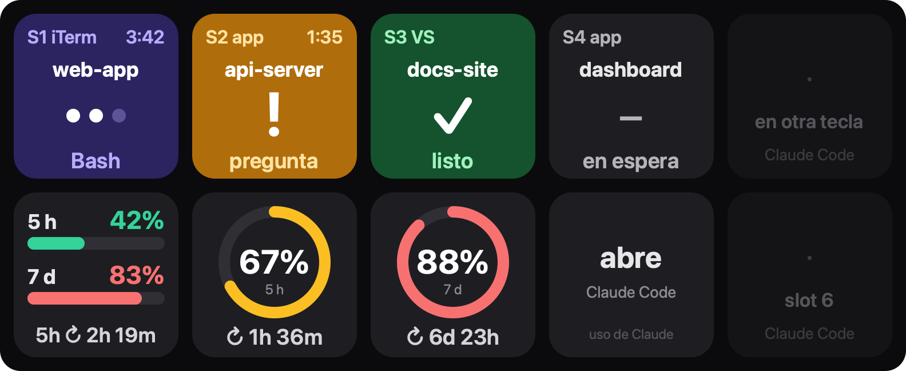

# Claude Deck

Plugin de Stream Deck para [Claude Code](https://code.claude.com): cada tecla muestra en vivo una sesión (trabajando, te necesita, lista), una pulsación te lleva a ella y otras teclas vigilan tu uso de Claude.

> **English summary:** Stream Deck plugin for Claude Code. Session keys show each live session's state (working, needs you, done, error), fed by Claude Code hooks with no polling. Pressing a key takes you to that session in the Claude desktop app, VS Code, iTerm2 or Terminal. Usage keys show your 5-hour and weekly Claude limits with a reset countdown. macOS, MIT licensed. The rest of this README is in Spanish.



> Proyecto personal y no oficial: no está afiliado ni respaldado por Anthropic ni por Elgato.

## Qué hace

| Acción | Qué muestra | De dónde salen los datos |
|---|---|---|
| **Sesión de Claude Code** | Proyecto, estado (trabajando · **te necesita** · listo · error), herramienta en curso, tiempo y dónde corre (app, VS Code, iTerm…). Pulsar te lleva a la sesión. | Hooks de Claude Code → script `claude-deck-notify.sh` → `POST 127.0.0.1:17875/event`. Sin polling. |
| **Uso de Claude** | Ventana de 5 h y semanal en %, color por umbral y cuenta regresiva al reinicio. | `GET api.anthropic.com/api/oauth/usage` con el token OAuth de Claude Code, leído (solo lectura) del Llavero. |

## Requisitos

- **macOS 12 o posterior.** Es la única plataforma probada; Windows figura en el manifest pero no se ha probado, y "ir a la sesión" es solo de macOS.
- **Stream Deck 6.9 o posterior.**
- **Claude Code reciente:** el plugin usa los hooks `PermissionRequest` y `StopFailure`.
- **Node.js 20 o posterior**, solo para compilar o usar las herramientas de terminal.

## Instalación

1. Descarga `com.aldomacias.claude-deck.streamDeckPlugin` de la [última release](https://github.com/aldomacias/streamdeck-claude-plugin/releases/latest) y ábrelo con doble clic → **Instalar**.
2. En la app de Stream Deck, categoría **Claude Deck**, arrastra **Sesión de Claude Code** a las teclas que quieras (una por sesión) y **Uso de Claude** a una o dos.
3. Selecciona una tecla de sesión y, en el panel de abajo, pulsa **Instalar / actualizar hooks de Claude Code**. Esto:
   - escribe `~/.claude/hooks/claude-deck-notify.sh`;
   - añade sus entradas a `~/.claude/settings.json`, con un respaldo automático `settings.json.bak-…`;
   - no toca tus otros hooks.
4. Reinicia las sesiones de Claude Code que tengas abiertas (o usa `/hooks`) para que carguen los hooks nuevos.
5. La primera consulta de uso abre el diálogo del Llavero de macOS (`security` quiere leer *Claude Code-credentials*). Elige **Permitir siempre**.

También puedes gestionar los hooks desde la terminal:

```bash
cd ~/Library/Application\ Support/com.elgato.StreamDeck/Plugins/com.aldomacias.claude-deck.sdPlugin
node bin/install-hooks.js            # instala o actualiza; --status | --uninstall | --port=NNNN
```

## Teclas de sesión

Cada sesión nueva de Claude Code toma el slot libre más bajo (S1, S2…) y no se mueve hasta que termina.

### Estados

| Tecla | Estado | Cuándo |
|---|---|---|
| Morada, puntos animados | **trabajando** | Enviaste un prompt; Claude usa herramientas (abajo, la herramienta en curso) o compacta. |
| Ámbar, «!», parpadea | **te necesita** | Pide un permiso, te hace una pregunta (`AskUserQuestion`), espera que apruebes un plan (`ExitPlanMode`) o cierra el turno preguntándote algo: en texto (el último mensaje termina en «?») o en el recuadro de siguiente paso de la app de escritorio. |
| Verde, ✓ | **listo** | Claude terminó su turno. |
| Roja, × | **error** | El turno falló por un error de la API. |
| Gris, «–» | **en espera** | Sesión abierta sin actividad, o ya confirmaste el aviso. |

Arriba a la izquierda verás el slot y dónde corre la sesión; arriba a la derecha, el tiempo en el estado actual.

### Pulsar

- **Pulsación corta:** te lleva a la sesión y confirma el aviso (ámbar o verde → en espera).
- **Mantener (1,2 s por defecto):** libera el slot. Úsalo si una terminal se cerró sin avisar.

### Ir a la sesión (macOS)

| Esquina | Dónde corre | Qué hace al pulsar |
|---|---|---|
| `app` | App de escritorio de Claude (pestaña Code) | Abre esa sesión con `claude://code/continue?session=local_…`. |
| `VS` | Panel de la extensión de VS Code, o `claude` en su terminal | Enfoca la ventana del proyecto. En el panel, además abre la sesión con `vscode://anthropic.claude-code/open?session=…`. |
| `iTerm` / `Term` | `claude` en iTerm2 / Terminal.app | Selecciona la ventana y la pestaña exactas con AppleScript. La primera vez macOS pide permiso para que Stream Deck controle esa app. |
| otro nombre | Otra app (Ghostty, Warp, Cursor…) | Trae esa app al frente. |

Si la esquina no dice dónde corre, la sesión todavía no ha mandado su origen (llega con su siguiente evento) y la pulsación muestra ⚠.

### Ajustes del inspector (por tecla)

| Ajuste | Qué hace |
|---|---|
| Slot (1–16) | Qué sesión muestra la tecla. |
| Proyecto | Sigue a la sesión cuya carpeta contenga este texto, en lugar del slot. |
| Al pulsar | «Ir a la sesión y confirmar» (por defecto) o «Solo confirmar». |
| Nombre | Texto propio en lugar del nombre de la carpeta. |
| Mantener | Cuánto mantener la tecla para liberar el slot (0,5–3 s). |
| Listo | Si la tecla verde vuelve sola a «en espera» tras 1–60 min. |
| Te necesita | Ámbar fijo en lugar de parpadeo. |
| Puerto | Puerto del servidor local, común a todas las teclas. Al cambiarlo, el plugin reabre el servidor y actualiza el notificador; no hace falta reiniciar Claude Code. |

Una sesión nunca aparece en dos teclas: si una tecla la sigue por proyecto, su tecla de slot queda vacía y dice «en otra tecla».

## Teclas de uso

- **Pulsar:** refresca en ese momento.
- **Métrica por tecla:** barras de 5 h y 7 días, anillo de 5 h o anillo de 7 días.
- **Intervalo:** desde 15 s. Todas las teclas comparten una sola consulta.
- **Umbrales:** ámbar desde 50 % y rojo desde 80 %, configurables.
- **Avisos:** «abre Claude Code» si no hay token o venció, «sin red» y «429» si el servicio limita las consultas. Siempre se conserva el último dato bueno.

## Cómo funciona

```
Claude Code ──hook (async)──▶ claude-deck-notify.sh ──POST 127.0.0.1:17875/event──▶ plugin ──▶ teclas de sesión
Llavero de macOS ──token (solo lectura)──▶ plugin ──GET api.anthropic.com/api/oauth/usage──▶ teclas de uso
```

- **Eventos que escucha:** SessionStart, UserPromptSubmit, PreToolUse, PostToolUse, PermissionRequest, Notification (permission_prompt, idle_prompt…), PreCompact, PostCompact, Stop, StopFailure y SessionEnd.
- **Origen de la sesión:** el notificador añade a la URL, ya saneadas, las variables que dicen dónde corre: `CLAUDE_CODE_ENTRYPOINT`, `__CFBundleIdentifier`, `TERM_PROGRAM`, `CLAUDE_CODE_HOST_SESSION_ID`, `ITERM_SESSION_ID` y, solo en Terminal.app, la TTY.

## Seguridad y privacidad

- **El token de Claude solo se lee.** Sale del Llavero (o de `~/.claude/.credentials.json` fuera de macOS), solo se envía a `api.anthropic.com`, nunca se escribe, refresca ni registra en logs, y ninguna herramienta imprime parte de él.
- **No guarda tus conversaciones.** Los hooks entregan su JSON al plugin por `127.0.0.1`. De ahí el plugin conserva en memoria solo:
  - id de sesión;
  - carpeta y nombre del proyecto;
  - estado y nombre de la herramienta;
  - origen de la sesión.

  Los prompts y las entradas de herramientas no se guardan. El registro de depuración (`/events`) guarda solo nombres de evento y de campo.
- **Sin telemetría.** La única conexión saliente es la consulta de uso a `api.anthropic.com`.
- **Servidor local cerrado.** Escucha solo en `127.0.0.1` y rechaza:
  - peticiones de navegador (cabecera `Origin`);
  - un `Host` que no sea ese puerto en loopback (DNS rebinding);
  - POST que no sean JSON;
  - cuerpos de más de 64 KB.

  Así una página web no puede inyectar sesiones falsas ni leer las tuyas.
- **«Ir a la sesión» no usa shell.** Ejecuta `open` u `osascript` con argumentos separados y valida cada identificador. Solo un editor de la familia VS Code recibe una ruta.
- **Lo que escribe en tu equipo:**
  - `~/.claude/hooks/claude-deck-notify.sh` y sus entradas en `~/.claude/settings.json`, con respaldo.
  - Al arrancar, el plugin actualiza ese script si ya existe y difiere de su versión (por ejemplo, tras una actualización). Nunca lo crea por su cuenta.
- **El notificador nunca frena a Claude Code:** corre como hook asíncrono, con `curl --max-time 1`, y siempre sale con código 0, aunque Stream Deck esté cerrado.

¿Encontraste una vulnerabilidad? Abre un issue sin detalles explotables y acordamos un canal privado.

## Límites conocidos

- **Endpoints no documentados:**
  - `oauth/usage` es el endpoint que usa Claude Code para `/usage`. Si cambia, la tecla muestra `--` y conserva el último dato. El `User-Agent` debe empezar por `claude-code/` y se puede cambiar en el inspector.
  - `claude://code/continue?session=…` es una ruta interna de la app de escritorio.
  - `CLAUDE_CODE_ENTRYPOINT` es una variable interna de Claude Code.

  Si cambian, deja de funcionar esa parte y lo demás sigue igual.
- **VS Code:** el enlace de la extensión abre la sesión en la ventana que esté al frente. Por eso el plugin enfoca antes la carpeta del proyecto; si la sesión corre en un worktree `…/.claude/worktrees/…`, enfoca la raíz del repo.
- **Esc:** Claude Code no lanza ningún hook cuando interrumpes con Esc. En la terminal, el aviso `idle_prompt` (~60 s) devuelve la tecla a «en espera»; en cualquier caso puedes pulsarla.
- **Preguntas en la app:** en la app de escritorio, `Stop` no trae el texto del último mensaje. Si Claude te pregunta solo en texto, sin recuadro ni `AskUserQuestion`, la tecla queda en «listo».

## Solución de problemas

```bash
cd ~/Library/Application\ Support/com.elgato.StreamDeck/Plugins/com.aldomacias.claude-deck.sdPlugin
node bin/probe.js                  # estado del servidor, sesiones vivas y prueba de la consulta de uso
node bin/probe.js --fake           # inyecta una sesión ficticia para ver la tecla cambiar de estado
curl -s 127.0.0.1:17875/events     # últimos 300 eventos recibidos y el estado que dejó cada uno
curl -s 127.0.0.1:17875/sessions   # sesiones que conoce el plugin
```

- **La tecla dice «puerto ocupado»:** otro proceso usa el 17875; cambia el **Puerto** en el inspector.
- **Pulsar no lleva a iTerm o Terminal:** revisa *Ajustes del Sistema → Privacidad y seguridad → Automatización* y permite que Stream Deck controle esa app.
- **Logs:** carpeta `logs/` del plugin y `~/Library/Logs/ElgatoStreamDeck/`.

## Desarrollo

```bash
npm install
npm run build        # rolldown → com.aldomacias.claude-deck.sdPlugin/bin/
npm test             # servidor, estados, notificador real, instalador, seguridad y caras (SVG en test/out/)
npm run typecheck
npm run validate     # validación del manifest con la CLI de Elgato
npm run pack         # → dist/com.aldomacias.claude-deck.streamDeckPlugin
npm run link && npm run restart   # desarrollo: enlaza la carpeta en Stream Deck y reinicia el plugin
npm run preview      # regenera docs/preview.svg
python3 scripts/make-icons.py      # regenera los iconos (requiere Pillow)
```

Antes de empaquetar una versión nueva, sube `Version` en `manifest.json`. Si no la cambias, Stream Deck da el paquete por instalado (`AlreadyInstalled`) y lo ignora.

| Archivo | Qué hace |
|---|---|
| `src/plugin.ts` | Arranque: registra las acciones y abre el servidor en el puerto configurado. |
| `src/server.ts` | Servidor local que recibe los hooks. |
| `src/sessions.ts` | Registro de sesiones: estados, slots y reparto entre teclas. |
| `src/jump.ts` | Detecta dónde corre cada sesión y cómo llegar a ella. |
| `src/hooks-install.ts` | Script notificador e instalación en `settings.json`. |
| `src/usage-store.ts` | Token y consulta de uso. |
| `src/render.ts` | Caras SVG de las teclas. |
| `src/actions/` | Acciones de Stream Deck (sesión y uso). |
| `src/cli/` | `install-hooks.js` y `probe.js`. |

## Desinstalar

1. Quita los hooks: `node bin/install-hooks.js --uninstall` desde la carpeta del plugin. Borra el script y sus entradas de `settings.json`, con respaldo.
2. Desinstala el plugin desde la app de Stream Deck.

## Licencia

[MIT](LICENSE) © 2026 Aldo Macias.

Claude y Claude Code son marcas de Anthropic. Stream Deck es marca de Elgato (Corsair).
